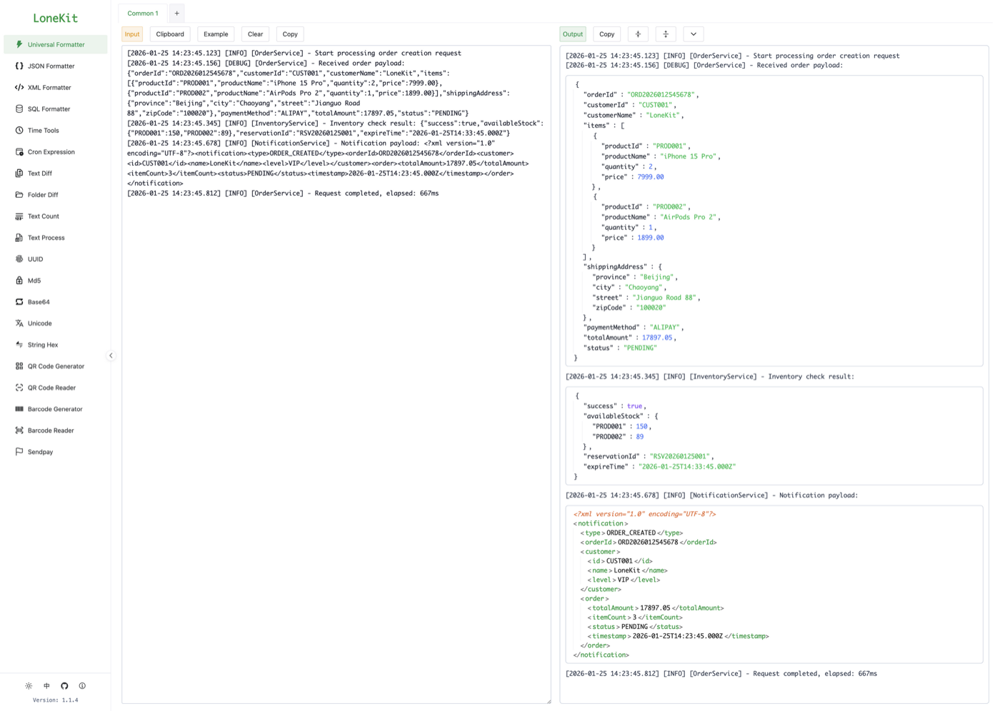
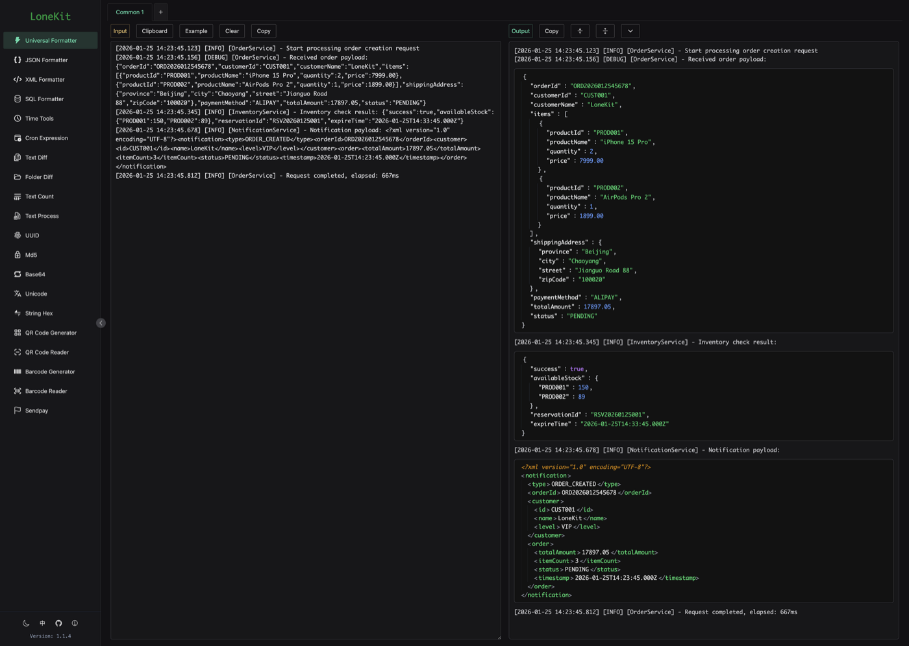
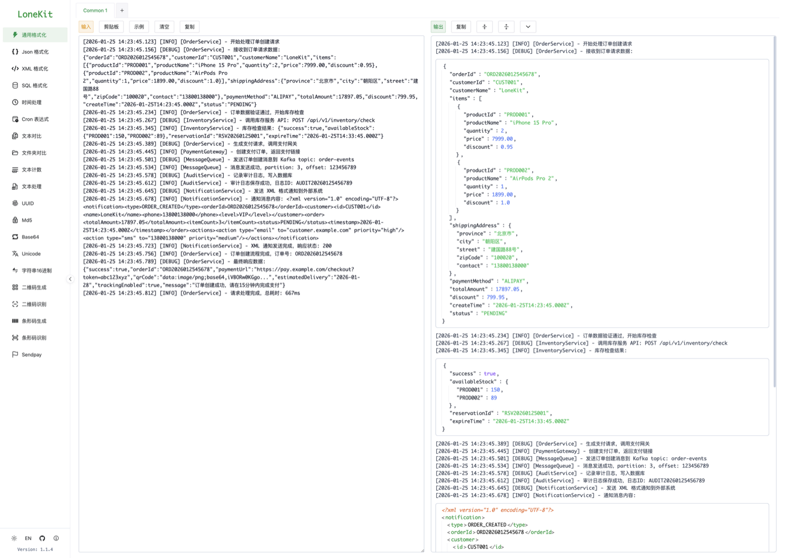
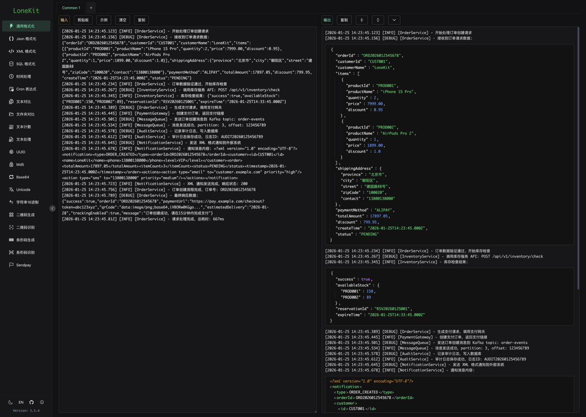

<div align="center">


# LoneKit

**A developer toolkit — same app on desktop and web**

Formatters, encoders, text diff, time and Cron, QR codes and barcodes — the small tools you reach for daily, in one window.

[](https://github.com/lonisletend/LoneKit/releases/latest)
[](https://github.com/lonisletend/LoneKit/releases)
[](LICENSE)


[中文](README.md) · [Screenshots](#screenshots) · [Use online](#use-online) · [Download](#download) · [Tools](#tools) · [Support](#support-the-project)

</div>

---

## Screenshots

The Universal Formatter: paste a messy log on the left, and every JSON / XML fragment inside it is detected and formatted on the right.

| | Light | Dark |
| :--: | :--: | :--: |
| **English** |  |  |
| **中文** |  |  |

## Use online

Both deployments serve the same build — pick whichever is faster on your network. No installation needed.

| Site | URL | Hosting |
| --- | --- | --- |
| Primary | **<https://kit.lonestack.com>** | Self-hosted server |
| Mirror | **<https://lonekit.vercel.app>** | Vercel |

Every tool computes locally in your browser; nothing you type is uploaded.

## Download

Grab the installer for your platform from [Releases](https://github.com/lonisletend/LoneKit/releases/latest):

| Platform | Installer |
| --- | --- |
| macOS (universal, Intel + Apple Silicon) | `LoneKit_<version>_universal.dmg` |
| Windows | `LoneKit_<version>_x64-setup.exe`, `LoneKit_<version>_x64_en-US.msi` |
| Linux | `LoneKit_<version>_amd64.deb`, `LoneKit_<version>_amd64.AppImage`, `LoneKit-<version>-1.x86_64.rpm` |

The desktop app updates itself and prompts in-app when a new version ships. Each release also contains `dist-v<version>.tar.gz`, the built frontend, ready to drop onto your own server.

> When self-hosting, unmatched paths must fall back to `index.html` (the router uses HTML5 history mode). For Nginx use `try_files $uri $uri/ /index.html;`; on Vercel the repo's `vercel.json` already handles it.

## Tools

### Formatting

| Tool | Route | Notes |
| --- | --- | --- |
| Universal Formatter | `/format` | Detects JSON / XML fragments mixed into a block of text and formats each one, with per-fragment JSONPath / XPath filtering |
| JSON Formatter | `/json` | Collapse/expand, key sorting, minify, JSONPath and JavaScript expression filtering |
| XML Formatter | `/xml` | Collapse/expand, sorting, minify, XPath filtering |
| SQL Formatter | `/sql` | Multiple dialects; the chosen dialect is remembered locally |

### Text

| Tool | Route | Notes |
| --- | --- | --- |
| Text Diff | `/diffs` | Side-by-side and line-by-line views with line-level highlighting |
| Folder Diff | `/folders` | Differences in directory structure and file contents |
| Text Count | `/count` | Characters (with and without whitespace), words, lines, paragraphs, UTF-8 bytes, estimated reading time |
| Text Process | `/text` | Twenty atomic operations — dedupe, sort, number lines, regex replace, collapse blank lines and more — chained into a pipeline |

### Encoding & conversion

| Tool | Route | Notes |
| --- | --- | --- |
| Base64 | `/base64` | Text ⇄ Base64 |
| Unicode | `/unicode` | Text ⇄ Unicode escapes |
| String Hex | `/hex` | Text ⇄ hexadecimal |
| MD5 | `/md5` | Batch digest calculation |
| UUID | `/uuid` | Generate v4 in bulk (up to 1000 at once), parse any version |

### Time

| Tool | Route | Notes |
| --- | --- | --- |
| Time Tools | `/time` | Timestamp conversion, interval calculation, time shifting |
| Cron Expression | `/cron` | Convert between 5/6/7-field formats, edit field by field, preview upcoming run times |

### Codes

| Tool | Route | Notes |
| --- | --- | --- |
| QR Code generate / read | `/qrcode`, `/qrcode-scan` | Generate and download, or decode from an image |
| Barcode generate / read | `/barcode`, `/barcode-scan` | CODE128, EAN13, EAN8 and other symbologies |

### Other

| Tool | Route | Notes |
| --- | --- | --- |
| Sendpay | `/sendpay` | Decodes and explains Sendpay flag positions from a configurable profile |

### Across the app

- **Multiple tabs** — most tools open several tabs in parallel, each with a renameable label
- **Favorites** — pin the tools you use most to the top of the menu, stored locally
- **Hand-off between tools** — send a formatted result straight into Text Diff
- **Light / dark theme** — follows the system or switches manually
- **English & Chinese** — interface and changelog in both languages
- **Works offline** — everything is computed locally

## Stack

`Tauri 2` · `Vue 3` (Composition API) · `Vite` · `Vue Router` · `Vue I18n` · `Naive UI` · `Tailwind CSS`

## Development

Requires Node.js 18+ and npm 9+; building the desktop app also needs a Rust toolchain.

```bash
npm install

npm run dev          # frontend dev server
npm run tauri dev    # desktop dev mode (needs Rust)

npm run build        # build frontend assets
npm run preview      # preview the build
npm run tauri build  # build desktop installers (needs Rust)

node --test src/utils/*.test.js   # run utility unit tests (node:test)
```

## Project structure

```text
.
├─ src/
│  ├─ components/
│  │  ├─ tools/        # one .vue per tool
│  │  ├─ wrapper/      # multi-tab shells
│  │  └─ common/       # shared components: SplitPanel, UpdateDialog, …
│  ├─ composables/     # useCommon / useTabManager / useSplitPanel, …
│  ├─ i18n/locales/    # translations and changelog
│  ├─ router/          # route config (all lazy-loaded)
│  └─ utils/           # pure functions and their tests
├─ src-tauri/          # Tauri/Rust shell and packaging config
├─ .github/workflows/  # pushing main builds all platforms and publishes a release
└─ vercel.json         # SPA route fallback for web deployment
```

## Contributing

- New tools follow the `Tool + Wrapper` pattern and register a lazy-loaded route in `src/router/index.js`
- For system capabilities (clipboard, shell, updater) reuse the existing composables such as `useCommon()`; they already handle the Tauri ↔ Web difference
- When adding a heavy dependency, revisit the chunk split in `vite.config.js`
- Versioning, changelog and release conventions are documented in [CLAUDE.md](CLAUDE.md)

Questions, suggestions or ideas are welcome in an [Issue](https://github.com/lonisletend/LoneKit/issues).

## About

LoneKit is a toolkit focused on development and testing scenarios.

Every tool comes from a real need at work, cutting out repetitive steps so developers can focus on creating.

If it saves you 5 minutes a day, spend that time with family, with yourself, and with life.

## Support the project

This project is maintained entirely in personal spare time — open source, powered by passion. Ads will never be embedded in tool pages as a revenue model.

If it helps you and you would like to support its continued development, I would be very grateful. Sponsorship only covers server, infrastructure and development costs; it grants **no feature privileges or extra services**. All features stay free and identical for everyone.

<table>
  <tr>
    <td align="center"><b>WeChat Pay</b></td>
    <td align="center"><b>Alipay</b></td>
  </tr>
  <tr>
    <td></td>
    <td></td>
  </tr>
</table>

**Token sponsorship**: if you have spare token quota you cannot use up, you can sponsor by email — the address is `eWFuZ3hqc3VuMDMyNEBnbWFpbC5jb20=` (Base64).

Please include your details when sponsoring; sponsors are listed on the in-app Thanks page, updated regularly.

## Thanks

Thank you to everyone who has accompanied this project from v0.0.1 to v1.0.0 — your feedback and suggestions are what shaped it.

Thank you to this AI era, which made many once-complex ideas far easier to realise.

And special thanks to her — this side project has taken quite a bit of time that should have been spent together, and I always seem to keep typing until one or two in the morning whenever inspiration strikes. 🫣

## License

[MIT](LICENSE) © lonisletend
