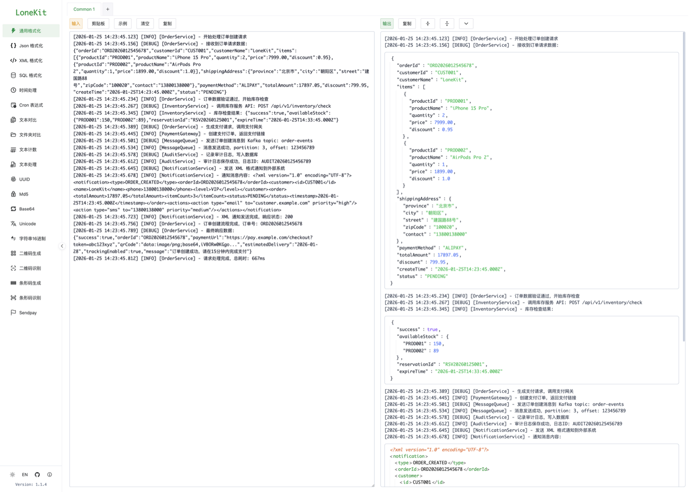
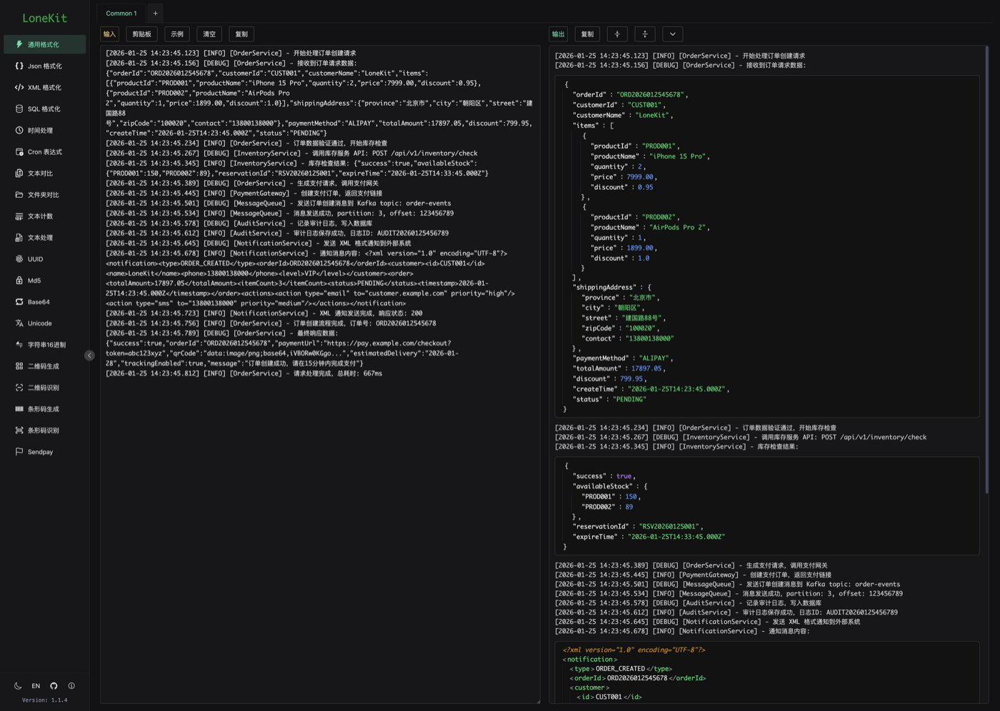
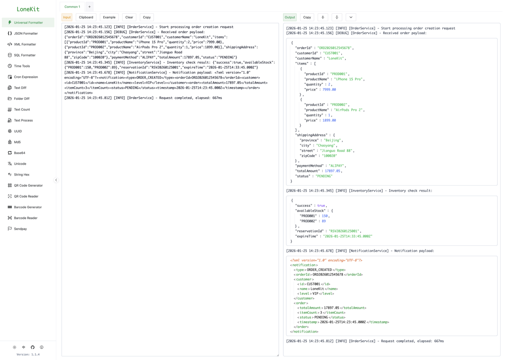
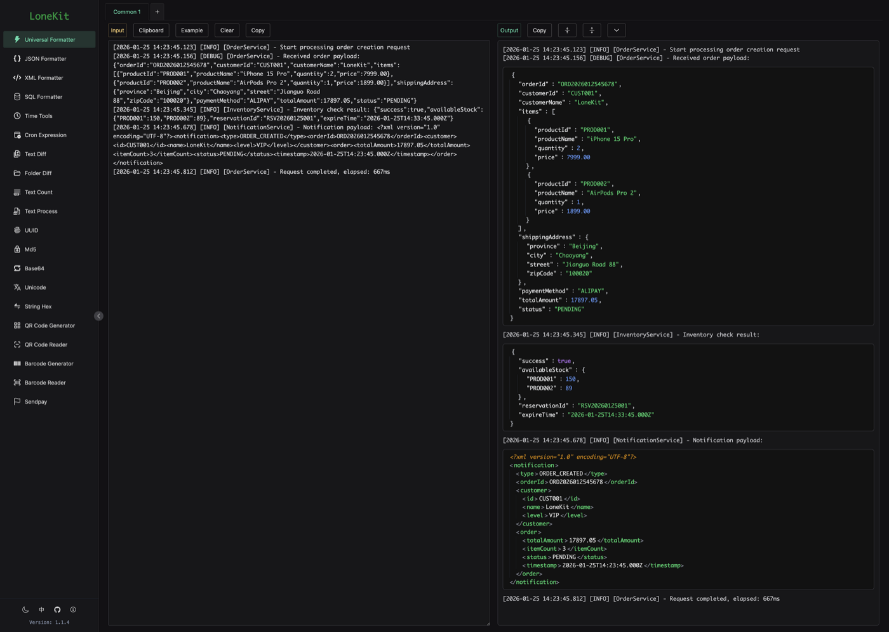

<div align="center">


# LoneKit

**开发者工具箱 · 桌面端与 Web 端同源**

格式化、编码解码、文本对比、时间与 Cron、二维码条形码——把高频小工具收进一个顺手的窗口。

[](https://github.com/lonisletend/LoneKit/releases/latest)
[](https://github.com/lonisletend/LoneKit/releases)
[](LICENSE)


[English](README.en.md) · [界面预览](#界面预览) · [在线使用](#在线使用) · [下载客户端](#下载客户端) · [功能清单](#功能清单) · [支持项目](#支持项目)

</div>

---

## 界面预览

以「通用格式化」为例——左侧粘贴混杂日志，右侧自动识别其中的 JSON / XML 片段并分别格式化。

| | 亮色 | 暗色 |
| :--: | :--: | :--: |
| **中文** |  |  |
| **English** |  |  |

## 在线使用

两套部署内容完全一致，按自己的网络情况挑一个更快的即可，无需安装。

| 线路 | 地址 | 托管 |
| --- | --- | --- |
| 主站 | **<https://kit.lonestack.com>** | 自建服务器 |
| 备用 | **<https://lonekit.vercel.app>** | Vercel |

所有工具均在浏览器本地完成计算，内容不会上传到任何服务器。

## 下载客户端

前往 [Releases](https://github.com/lonisletend/LoneKit/releases/latest) 下载对应平台的安装包：

| 平台 | 安装包 |
| --- | --- |
| macOS（Intel / Apple Silicon 通用） | `LoneKit_<版本>_universal.dmg` |
| Windows | `LoneKit_<版本>_x64-setup.exe`、`LoneKit_<版本>_x64_en-US.msi` |
| Linux | `LoneKit_<版本>_amd64.deb`、`LoneKit_<版本>_amd64.AppImage`、`LoneKit-<版本>-1.x86_64.rpm` |

桌面端内置自动更新，发布新版本后会在应用内提示升级。另有 `dist-v<版本>.tar.gz` 为前端静态产物，可直接部署到自己的服务器。

> 自部署时需要把未命中的路径回退到 `index.html`（路由使用 HTML5 history 模式）。Nginx 用 `try_files $uri $uri/ /index.html;`，Vercel 可直接复用仓库中的 `vercel.json`。

## 功能清单

### 格式化

| 工具 | 路径 | 说明 |
| --- | --- | --- |
| 通用格式化 | `/format` | 自动识别一段文本里混杂的 JSON / XML 片段并分别格式化，每个片段支持独立的 JSONPath / XPath 过滤 |
| JSON 格式化 | `/json` | 折叠展开、键排序、压缩、JSONPath 与 JavaScript 表达式过滤 |
| XML 格式化 | `/xml` | 折叠展开、排序、压缩、XPath 过滤 |
| SQL 格式化 | `/sql` | 多方言格式化，方言选择本地留存 |

### 文本

| 工具 | 路径 | 说明 |
| --- | --- | --- |
| 文本对比 | `/diffs` | 并排与逐行两种视图，行级差异高亮 |
| 文件夹对比 | `/folders` | 目录结构与文件内容差异 |
| 文本计数 | `/count` | 字符数、不含空白字符数、单词、行、段落、UTF-8 字节数与预估阅读时长 |
| 文本处理 | `/text` | 行去重、排序、编号、正则替换、空行压缩等二十种原子操作，可串成处理链依次执行 |

### 编码与转换

| 工具 | 路径 | 说明 |
| --- | --- | --- |
| Base64 | `/base64` | 文本与 Base64 互转 |
| Unicode | `/unicode` | Unicode 转义互转 |
| 字符串 Hex | `/hex` | 字符串与十六进制互转 |
| MD5 | `/md5` | 批量摘要计算 |
| UUID | `/uuid` | 批量生成 v4（单次最多 1000 个），解析任意版本 |

### 时间

| 工具 | 路径 | 说明 |
| --- | --- | --- |
| 时间处理 | `/time` | 时间戳转换、时间间隔计算、时间推移计算 |
| Cron 表达式 | `/cron` | 5/6/7 段格式互转、按字段结构化编辑、推算后续运行时间 |

### 二维码与条形码

| 工具 | 路径 | 说明 |
| --- | --- | --- |
| 二维码生成 / 识别 | `/qrcode`、`/qrcode-scan` | 生成下载，或从图片中识别 |
| 条形码生成 / 识别 | `/barcode`、`/barcode-scan` | CODE128、EAN13、EAN8 等码制的生成与识别 |

### 其他

| 工具 | 路径 | 说明 |
| --- | --- | --- |
| Sendpay | `/sendpay` | 按配置解析并展示 Sendpay 标位含义 |

### 贯穿全局的能力

- **多标签页**：大部分工具支持开多个标签并行处理，标签名可重命名
- **菜单收藏**：常用工具置顶，按用户本地留存
- **工具间流转**：格式化结果可一键发送到文本对比
- **明暗主题**：跟随系统或手动切换
- **中英双语**：界面与更新日志均双语
- **离线可用**：所有计算在本地完成

## 技术栈

`Tauri 2` · `Vue 3`（Composition API）· `Vite` · `Vue Router` · `Vue I18n` · `Naive UI` · `Tailwind CSS`

## 本地开发

环境要求：Node.js 18+、npm 9+，构建桌面端还需要 Rust toolchain。

```bash
npm install

npm run dev          # 前端开发服务器
npm run tauri dev    # 桌面端开发模式（需要 Rust）

npm run build        # 构建前端产物
npm run preview      # 预览构建结果
npm run tauri build  # 构建桌面安装包（需要 Rust）

node --test src/utils/*.test.js   # 运行工具函数单测（node:test）
```

## 项目结构

```text
.
├─ src/
│  ├─ components/
│  │  ├─ tools/        # 工具组件，每个工具一个 .vue
│  │  ├─ wrapper/      # 多标签页包装层
│  │  └─ common/       # SplitPanel、UpdateDialog 等共享组件
│  ├─ composables/     # useCommon / useTabManager / useSplitPanel 等
│  ├─ i18n/locales/    # 中英文案与更新日志
│  ├─ router/          # 路由配置（全部懒加载）
│  └─ utils/           # 纯函数与单测
├─ src-tauri/          # Tauri/Rust 容器与打包配置
├─ .github/workflows/  # 推送 main 触发三平台构建与发版
└─ vercel.json         # Web 部署的 SPA 路由回退
```

## 参与开发

- 新增工具遵循 `Tool + Wrapper` 双层结构，并在 `src/router/index.js` 注册懒加载路由
- 需要剪贴板、Shell、更新等系统能力时，复用 `useCommon()` 等已有 composable，它们已处理 Tauri 与 Web 的差异
- 引入重依赖时同步检查 `vite.config.js` 的分包策略
- 版本号、更新日志与发布流程的约定见 [CLAUDE.md](CLAUDE.md)

有问题、建议或想法，欢迎提 [Issue](https://github.com/lonisletend/LoneKit/issues)。

## 关于

LoneKit 是一个专注于开发与测试场景的工具集。

每一个工具都源于真实工作中的需求，旨在减少琐碎操作，让开发者更专注于创造本身。

如果它能帮你每天节省 5 分钟，请把这些时间留给家人，留给自己，留给生活。

## 支持项目

这个项目目前完全由个人业余时间维护，属于用爱发电的开源项目。未来也不会通过在工具页面接入广告的方式作为盈利或收入来源。

如果它对你有帮助，并且你愿意支持它继续发展，我将非常感激。赞助仅用于支持服务器、基础设施与开发成本，**不会带来任何功能特权或额外服务**，所有功能对所有用户始终保持免费与一致。

<table>
  <tr>
    <td align="center"><b>微信支付</b></td>
    <td align="center"><b>支付宝</b></td>
  </tr>
  <tr>
    <td></td>
    <td></td>
  </tr>
</table>

**Token 赞助**：如果你手头有空闲的 Token 消耗不完，可以通过邮件联系赞助，邮箱为 `eWFuZ3hqc3VuMDMyNEBnbWFpbC5jb20=`（Base64）。

请在赞助时备注您的信息，赞助信息将会定期更新在应用内的致谢页。

## 致谢

感谢陪伴这个项目从 v0.0.1 走到 v1.0.0 的所有使用者，是你们的反馈与建议，让它不断完善并成长至今。

感谢这个 AI 时代，让许多原本复杂的想法得以更轻松地被实现。

特别感谢她——这个业余项目占用了不少本该用于陪伴的时间。而且我总是在有灵感的时候敲键盘到深夜一两点。🫣

## 许可证

[MIT](LICENSE) © lonisletend
